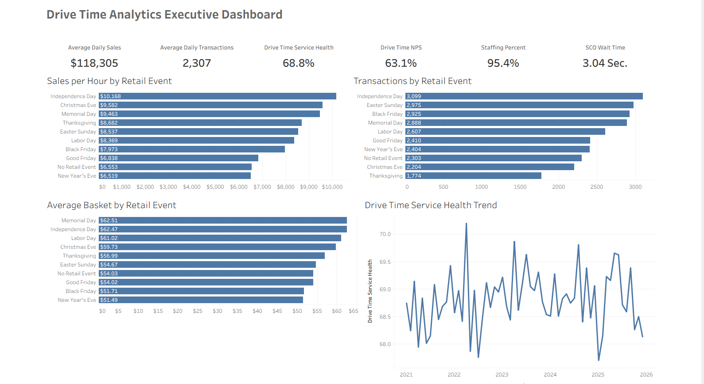

# Drive Time Analytics

An end-to-end retail analytics portfolio project exploring the operational factors associated with customer experience and business performance during peak shopping hours.

## Live Interactive Application

Launch the Drive Time Analytics Streamlit app

(https://drivetime-analytics.streamlit.app/)

Explore the five-year synthetic retail dataset through interactive filters, responsive KPIs, two fiscal-year animations, relationship exploration, and model diagnostics.

## Project Overview

Drive Time Analytics is a fictional retail analytics environment I developed to practice the full analytical process, from data validation and exploratory analysis through predictive modeling, statistical diagnostics, and executive dashboard development.

The project is based on a retail operations concept I call **Drive Time**, focused on the **2 PM to 5 PM peak shopping period**. The primary goal is to understand which operational conditions appear most closely associated with Service Health, Drive Time Service Health, NPS, and business performance.

All data used in this project is synthetic and AI-assisted. The results represent relationships within the fictional dataset and should not be interpreted as actual store or company performance.

## Project Highlights

- Built and validated a five-year synthetic retail dataset containing **1,826 daily observations and 89 variables**.
- Identified and corrected data-quality issues before modeling, including a column-alignment problem and ceiling effects in customer-experience variables.
- Used Orange Data Mining for data validation, exploratory analysis, correlation analysis, feature ranking, regression, and cross-validated model comparison.
- Tested an initial hypothesis that additional Drive Time labor coverage would be associated with better customer outcomes. The results did not support that simple relationship, which shifted the analysis toward staffing adequacy and customer-facing execution.
- Compared Linear Regression, Regression Tree, Random Forest, and Gradient Boosting against a Constant baseline. Linear Regression produced the strongest cross-validated results for the selected operational predictors.
- Used Python to independently verify selected Orange findings and extend the analysis through regression diagnostics, confidence intervals, multicollinearity analysis, residual analysis, and influential-observation testing.
- Reduced the preferred explanatory regression from eight to seven predictors after identifying substantial multicollinearity involving Labor Variance.
- Developed a Tableau executive dashboard to translate the analytical results into a concise business-facing presentation.
- Developed a five-page Streamlit application for interactive exploration, including responsive filters and KPIs, two fiscal-year animations, relationship analysis, and model diagnostics.

## Executive Dashboard



The final Tableau dashboard provides an executive view of sales, transaction volume, Drive Time customer outcomes, staffing levels, self-checkout waiting, Retail Event performance, and the Drive Time Service Health trend.

The dashboard was intentionally kept concise. I tested denser layouts during development, but the final 2 x 2 analytical layout provided a better balance between information density and readability.

**Tableau files:**
- [Tableau workbook](tableau/DriveTime_Analytics_Executive_Dashboard.twb)
- [Packaged Tableau workbook](tableau/DriveTime_Analytics_Executive_Dashboard.twbx)

## Business Questions

The project was built around several questions:

- Which operational factors have the strongest relationships with Service Health?
- Which factors are associated with Drive Time Service Health?
- What appears to influence NPS and Drive Time NPS?
- How do staffing, checkout performance, product availability, customer waiting, and store execution relate to customer outcomes?
- How do Retail Events and reduced operating hours affect sales, transactions, average basket, and sales intensity?
- Can machine learning models predict selected customer-experience outcomes using operational measures?

## Dataset

The corrected dataset contains:

- **1,826 daily observations**
- **89 variables**
- Five years of fictional retail activity
- Customer-experience measures
- Sales and transaction measures
- Labor and scheduling measures
- Product-availability measures
- Checkout and self-checkout measures
- Pickup and fulfillment measures
- Operational-execution measures
- Holiday and Retail Event indicators

Christmas Day is modeled as a closed-store day, while selected events use reduced operating hours.

The dataset went through multiple validation and correction steps before the final version was used for modeling.

**Artifacts:**
- [Corrected dataset v1.3](data/DriveTime_Analytics_AI_Corrected_v1.3.xlsx)
- [89-variable data dictionary](data/DriveTime_Analytics_Data_Dictionary_v1.2.docx)

## Analytical Process

### 1. Data Validation and Revision

I started by validating the dataset in Orange rather than assuming the AI-assisted data was ready for analysis.

That review identified two important issues. First, the final operational fields in an early version of the dataset were misaligned, leaving Leadership Effectiveness blank. Second, Checkout Experience and Drive Time Checkout Experience showed a strong ceiling effect, with values concentrated near their maximum.

I corrected the data structure, expanded the holiday and Retail Event logic, revised the two checkout-experience measures, and recalculated the dependent customer-experience outcomes. The final corrected dataset became version 1.3.

**Supporting evidence:**
- [Corrected v1.3 column statistics](orange/outputs/Corrected_v1.3_Column_Statistics.html)
- [Orange workflow](orange/DriveTime_ExploratoryAnalysis_v1.3.ows)

### 2. Exploratory Analysis in Orange

I used correlation analysis, scatter plots, and Retail Event comparisons to look for relationships worth investigating further.

For overall Service Health:

- Checkout Experience had a Pearson correlation of approximately **+0.45**.
- Customer Wait Time had a correlation of approximately **-0.23**.
- Staffing Percent had a correlation of approximately **+0.27**.

For Drive Time Service Health:

- Drive Time Checkout Experience had a correlation of approximately **+0.57**.
- Drive Time Wait Time had a correlation of approximately **-0.25**.

I also compared Pearson and Spearman results to make sure the primary relationships were not being driven only by a small number of extreme observations.

**Supporting evidence:**
- [Service Health Pearson correlations](orange/outputs/ServiceHealth_Correlations_Pearson_v1.3.html)
- [Drive Time Service Health Spearman correlations](orange/outputs/DriveTimeServiceHealth_Correlations_Spearman_v1.3.html)
- [Final Orange workflow image](images/Orange_Final_Workflow.png)

### 3. Testing the Labor-Coverage Hypothesis

One of my original expectations was that additional Drive Time labor coverage would be associated with shorter wait times and better customer outcomes.

The data did not support that simple relationship. Drive Time Coverage Hours showed approximately:

- **+0.02** correlation with Drive Time Wait Time
- **-0.06** correlation with Drive Time Checkout Experience
- **+0.01** correlation with Drive Time Service Health

I then adjusted coverage for customer demand using `DriveTimeTransactionsPerCoverageHour`. The workload-adjusted relationships were still close to zero.

That changed the direction of the project. Instead of continuing to ask whether more labor automatically produced better results, I shifted the question toward whether staffing adequacy, execution, checkout conditions, and associate capability helped explain why similar levels of labor coverage could produce different customer outcomes.

This was one of the most important lessons in the project. I had an expectation, tested it, tried another reasonable measurement approach, and accepted the result when the evidence still did not support my original assumption.

**Supporting evidence:**
- [Coverage vs. Drive Time Service Health](orange/outputs/Chart_14_DriveTime_Coverage_vs_ServiceHealth.docx)

### 4. Retail Event Analysis

Retail Events did not affect the business in the same way. I compared Daily Sales, Transactions, Average Basket, and Sales per Operating Hour.

Sales per Operating Hour was especially useful for reduced-hour events. Looking only at daily sales could make a shortened operating day appear weak even when the store generated strong sales intensity while it was open.

The final Tableau dashboard therefore keeps both overall business volume and sales intensity visible.

**Supporting evidence:**
- [Sales per Operating Hour analysis](orange/outputs/Chart_07_Sales_Per_Operating_Hour_By_Retail_Event.docx)
- [Sales per Operating Hour visual](images/Sales_Per_Operating_Hour_By_Retail_Event.png)

### 5. Predictive Modeling in Orange

I moved from pairwise relationships into multivariable modeling using a controlled operational predictor set. Closely related customer-experience outcomes were intentionally excluded from the predictor set to reduce outcome leakage.

I compared:

- Constant baseline
- Linear Regression
- Regression Tree
- Random Forest
- Gradient Boosting

using **10-fold cross-validation**.

For Drive Time Service Health, Linear Regression produced the strongest baseline performance:

- **RMSE: 3.130**
- **MAE: 2.476**
- **R²: 0.059**

A reduced eight-feature Linear Regression produced the same displayed cross-validation results as the original 15-feature model.

I also modeled Drive Time NPS using the same eight operational predictors. Linear Regression again performed best:

- **RMSE: 4.304**
- **MAE: 3.395**
- **R²: 0.047**

The results showed that the operational predictors contained measurable but limited predictive information. More complex models did not improve performance.

**Supporting evidence:**
- [Drive Time Service Health Test & Score](orange/outputs/TestAndScore_DriveTime_ServiceHealth.png)
- [Drive Time NPS Test & Score](orange/outputs/TestAndScore_DriveTime_NPS.png)
- [Service Health coefficients](orange/outputs/ServiceHealth_Coefficients.png)
- [Drive Time NPS coefficients](orange/outputs/DriveTime_NPS_Coefficients.png)

### 6. Statistical Validation in Python

I used Python to independently reproduce selected Orange findings and examine the regression in more detail.

The Python analysis included:

- Correlation verification
- Multiple regression
- Statistical significance
- Confidence intervals
- Variance Inflation Factors
- Residual diagnostics
- Q-Q analysis
- Cook's Distance
- Sensitivity testing

The eight-feature Python regression produced:

- **R²: 0.075**
- **Adjusted R²: 0.070**

Variance Inflation Factor analysis identified substantial overlapping information involving Labor Variance. Labor Variance had a VIF of approximately **9.86**.

I removed Labor Variance and tested a seven-feature model. The preferred seven-feature model produced:

- **R²: 0.075**
- **Adjusted R²: 0.071**
- **AIC: 9308.284**
- **BIC: 9352.341**

The highest remaining predictor VIF fell to approximately **2.70**.

Two predictors remained statistically significant in the preferred model:

**Staffing Percent**
- Coefficient: **+0.2112**
- 95% confidence interval: approximately **+0.1336 to +0.2888**
- Positive association with Drive Time Service Health

**SCO Wait Time**
- Coefficient: **-0.8089**
- 95% confidence interval: approximately **-1.0952 to -0.5225**
- Negative association with Drive Time Service Health

The overall model remained limited in explanatory power, so these coefficients are treated as relationships within the synthetic dataset rather than strong operational recommendations.

**Python analysis:**
- [Python/Colab notebook](python/DriveTime_Python_Analysis_v1_0.ipynb)
- [Rendered Python analysis](python/DriveTime_Python_Analysis_v1_0.pdf)
- [Model comparison](python/outputs/Python_Model_Comparison.csv)
- [Service Health coefficients](python/outputs/Python_ServiceHealth_Coefficients.csv)
- [Preferred-model VIF results](python/outputs/Python_VIF_Preferred_Model.csv)
- [Residuals vs. predicted values](python/outputs/Chart_Residuals_vs_Predicted_Values.png)
- [Q-Q plot](python/outputs/Chart_Q-Q_Plot_of_Regression_Residuals.png)

### 7. Executive Dashboard Development in Tableau

The final phase of the completed analytical work focused on communication rather than discovering new relationships.

The Tableau dashboard uses six KPI cards and four primary visualizations. The Retail Event charts use a consistent event population so the different business measures can be compared more easily.

Supporting analyses such as Staffing Percent versus Drive Time Service Health and SCO Wait Time versus Drive Time Service Health were preserved without overcrowding the main executive dashboard.

**Supporting visuals:**
- [Staffing Percent vs. Drive Time Service Health](images/StaffingPercent_vs_DriveTimeServiceHealth.png)
- [SCO Wait Time vs. Drive Time Service Health](images/SCOWaitTime_vs_DriveTimeServiceHealth.png)

## Interactive Streamlit Application

The completed Streamlit application extends the project from static reporting into interactive exploration. Rather than recreating the Tableau executive dashboard, the app lets a user filter, animate, and investigate the underlying synthetic data and saved model evidence.

The application contains five pages:

- **Executive Overview** with Fiscal Year, Retail Event, Day of Week, and Day Type filters; six responsive KPI cards; and a selectable interactive Drive Time performance trend.
- **Retail Event Explorer** with an animated 2021-2025 Retail Event comparison for Sales per Operating Hour, Transactions, Average Basket, and Drive Time Service Health, plus event-level KPI details.
- **Relationship Explorer** with an animated Staffing Percent versus Drive Time Service Health scatterplot by Fiscal Year and an interactive SCO Wait Time companion analysis.
- **Model Results** with preferred-model KPIs, regression coefficients and 95% confidence intervals, model comparison, VIF diagnostics, and the saved residual and Q-Q diagnostic plots.
- **About the Project** with the Drive Time concept, project purpose, analytical workflow, tools, key analytical lesson, and synthetic-data disclaimer.

The two animations serve different analytical purposes: Retail Event performance shows how event-level business measures change by fiscal year, while the staffing relationship animation shows how the Staffing Percent and Drive Time Service Health point cloud changes across the five-year dataset.

**Streamlit source:**
- [Application entrypoint](streamlit/app.py)
- [Application pages](streamlit/pages/)
- [Deployment requirements](streamlit/requirements.txt)

Live application: https://drivetime-analytics.streamlit.app

## Key Findings

### Raw coverage quantity did not explain customer outcomes well

Raw Drive Time Coverage Hours showed almost no direct relationship with Drive Time Service Health. Adjusting coverage for transaction workload did not materially change that result.

### Staffing adequacy showed a more consistent relationship

Staffing Percent showed a positive relationship with Drive Time Service Health and remained statistically significant in the preferred Python regression.

### SCO Wait Time showed a consistent negative relationship

Longer SCO Wait Time was associated with lower Drive Time Service Health and remained statistically significant after controlling for the other selected predictors.

### Simpler models performed better

Linear Regression outperformed the more complex models tested in Orange. The low R² values also showed that model complexity could not compensate for information that was not present in the available daily aggregate predictors.

### Model simplification improved interpretability

Removing Labor Variance reduced multicollinearity without reducing displayed R². This resulted in a simpler seven-feature explanatory model.

### Retail Events need context

Total sales alone did not tell the full story for reduced-hour events. Comparing Sales per Operating Hour, Transactions, and Average Basket provided a more useful picture of event performance.

## Model Performance and Limitations

The selected operational models were intentionally evaluated without closely related customer-experience outcomes that could introduce outcome leakage. That created a more difficult prediction problem and produced relatively low R² values.

The daily dataset also does not capture:

- Short-duration traffic surges
- Exact associate deployment
- Temporary staffing gaps within the day
- Transaction complexity
- Other conditions that may influence customer experience during peak hours

The findings therefore should not be interpreted as proof of cause and effect. Instead, the project demonstrates how exploratory analysis, predictive modeling, statistical diagnostics, and business context can be combined to evaluate evidence and refine an analytical question.

## Tools Used

- Microsoft Excel
- Orange Data Mining
- Python
- pandas
- statsmodels
- Google Colab
- Tableau
- GitHub
- Microsoft Copilot

Streamlit has been completed as the interactive exploration phase of the project.

## Repository Structure

```text
DriveTime-Analytics/
|
├── data/
|   ├── DriveTime_Analytics_AI_Corrected_v1.3.xlsx
|   └── DriveTime_Analytics_Data_Dictionary_v1.2.docx
|
├── documentation/
|   └── DriveTime_Project_Journal_v1.2.docx
|
├── images/
|   ├── DriveTime_Executive_Dashboard.png
|   ├── Orange_Final_Workflow.png
|   ├── Sales_Per_Operating_Hour_By_Retail_Event.png
|   ├── SCOWaitTime_vs_DriveTimeServiceHealth.png
|   └── StaffingPercent_vs_DriveTimeServiceHealth.png
|
├── orange/
|   ├── DriveTime_ExploratoryAnalysis_v1.3.ows
|   └── outputs/
|
├── python/
|   ├── DriveTime_Python_Analysis_v1_0.ipynb
|   ├── DriveTime_Python_Analysis_v1_0.pdf
|   └── outputs/
|
├── tableau/
|   ├── DriveTime_Analytics_Executive_Dashboard.twb
|   └── DriveTime_Analytics_Executive_Dashboard.twbx
|
└── streamlit/
    ├── app.py
    ├── requirements.txt
    ├── data/
    ├── outputs/
    └── pages/
```

## Project Documentation

A complete project journal documents how the analysis developed, including data-quality problems, revisions, hypotheses, unexpected findings, modeling decisions, and lessons learned.

- [Project Journal v1.2](documentation/DriveTime_Project_Journal_v1.2.docx)
- [Data Dictionary v1.2](data/DriveTime_Analytics_Data_Dictionary_v1.2.docx)

The journal is intentionally more detailed than this README. The README provides the project summary, while the journal preserves the analytical process and decision history.

## Next Phase

The interactive Streamlit application is deployed and publicly accessible at:

https://drivetime-analytics.streamlit.app

The GitHub repository contains the completed analytical artifacts and application source.

## Data Disclaimer

This project uses fictional, synthetic, and AI-assisted retail data created for learning and portfolio development.

The project does not contain actual store performance data, customer data, employee data, or company operational results.

All findings describe relationships within the synthetic analytical environment and should not be interpreted as evidence about an actual retail location or organization.
